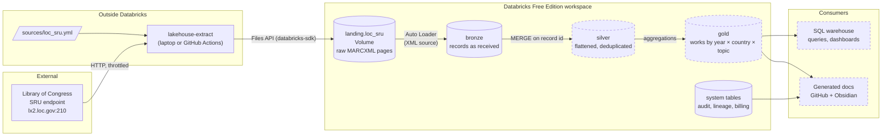
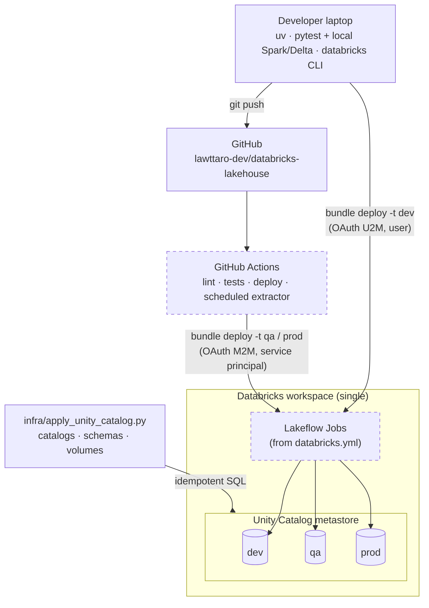
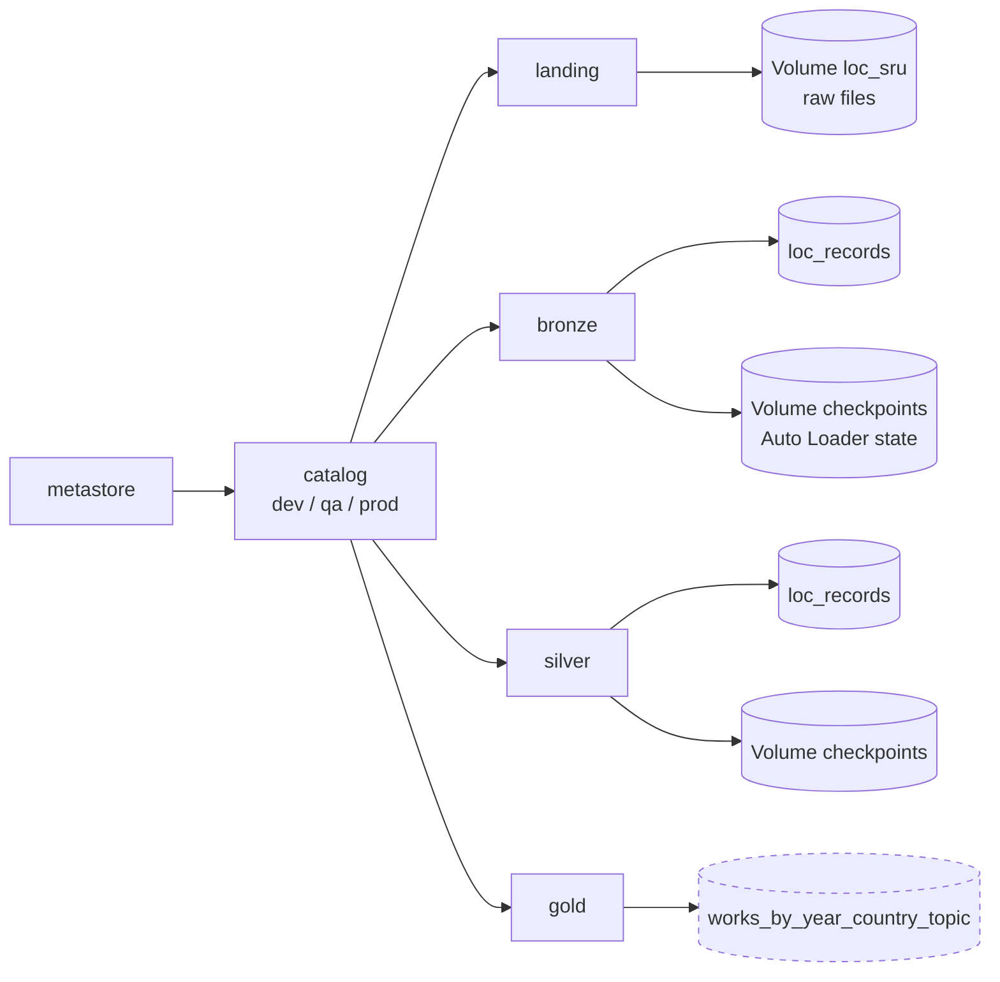
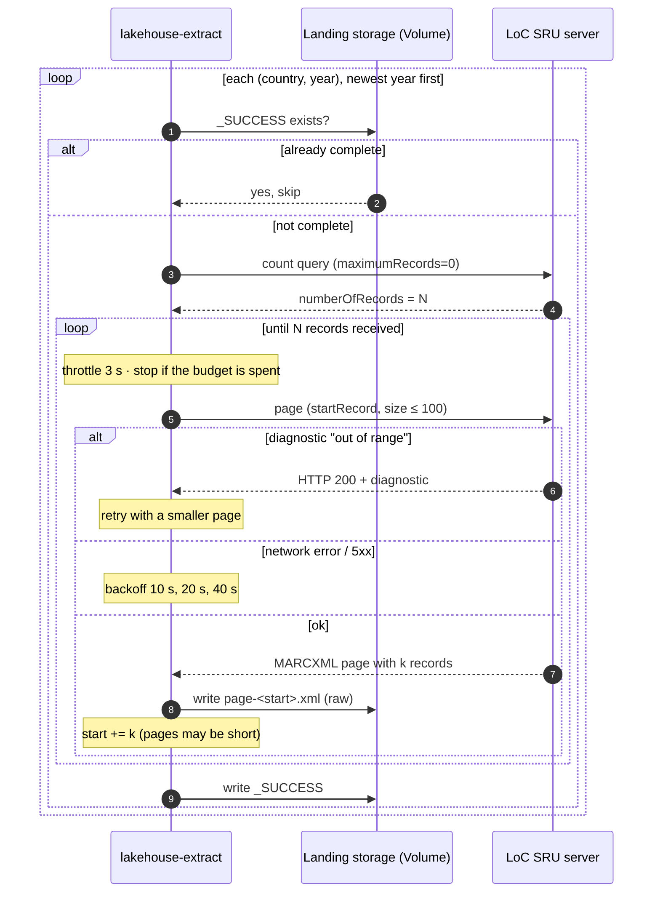
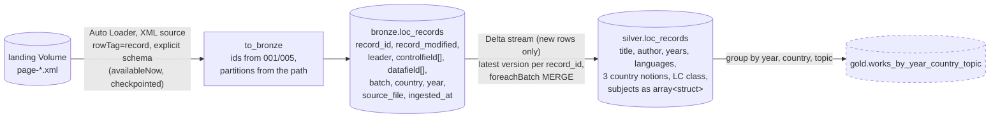

# Architecture

How the lakehouse is built: components, data flow, environments and identities.
Decisions behind each piece are in [03-decisions.md](03-decisions.md). Day-to-day commands: [05-operations.md](05-operations.md). Surprises along the way: [06-lessons-learned.md](06-lessons-learned.md). The source is described in [02-data-source-loc-catalog.md](02-data-source-loc-catalog.md).

Diagrams use [Mermaid](https://mermaid.js.org/), which GitHub and Obsidian render natively. Dashed boxes are **planned**, solid boxes are **implemented**.

## 1. Goal and constraints

Build a world bibliographic catalog (what was written about each country, per year and topic) on Databricks, with versioned code, three environments, CI/CD and generated documentation.

| Constraint | Effect on the design |
|---|---|
| Databricks Free Edition: one workspace, serverless only | Environments are catalogs, not workspaces (ADR-001) |
| Free Edition restricts outbound internet | Extraction runs outside Databricks (ADR-005) |
| Zero budget | GitHub Actions for CI and scheduling; small, incremental loads |
| Learning project | Plain PySpark on Lakeflow Jobs instead of declarative pipelines (ADR-007) |

## 2. System overview



## 3. Environments and deployment

One workspace, one Unity Catalog metastore, one catalog per environment. Code ships through an Asset Bundle with one target per environment. Long-lived data containers (catalogs, schemas, volumes) are managed separately, so a bundle change can never drop data (ADR-010).



| Target | Bundle mode | Deployed by | Catalog | Schedules |
|---|---|---|---|---|
| `dev` | `development` (resources prefixed `[dev <user>]`) | Developer, from the laptop | `dev` | Paused |
| `qa` | `production` | CI on merge to `main` | `qa` | Active |
| `prod` | `production` | CI on release tag | `prod` | Active |

### Identities

| Identity | Authentication | Used for |
|---|---|---|
| Developer user | OAuth U2M (`databricks auth login`, token in the OS keyring) | Local CLI, `dev` deploys, exploration |
| CI service principal | OAuth M2M (client id + secret in GitHub secrets) | `qa` / `prod` deploys and scheduled extraction |

Verified on Free Edition: service principals and M2M secrets work; a principal needs the `workspace-access` entitlement (ADR-003).

## 4. Unity Catalog layout

The same layout is repeated in `dev`, `qa` and `prod` (`infra/unity_catalog.sql`).



| Schema | Holds | Rule |
|---|---|---|
| `landing` | Volumes with files exactly as the source returned them | Never transformed, never deleted by pipelines |
| `bronze` | One Delta row per source record, the full record kept, plus ingestion metadata. Volume `checkpoints` for streaming state | Append/merge only, nothing dropped |
| `silver` | Canonical flattened records per source, deduplicated on the source record id. Volume `checkpoints` | Business rules and typing happen here |
| `gold` | Aggregates for analysis | Rebuilt from silver |

## 5. Extraction

### Landing layout

```
/Volumes/<catalog>/landing/loc_sru/
└── batch=<batch>/                    backfill-<from>-<to>  |  window-<YYYY-MM-DD>
    └── country=<CC>/                 AR, MX, BR, CL (sources/loc_sru.yml)
        └── year=<YYYY>/              publication year
            ├── page-000001.xml       raw SRU response, named by first record position
            ├── page-000027.xml
            └── _SUCCESS              JSON: query, total_records, harvested_at
```

Hive-style `key=value` folders become columns (`batch`, `country`, `year`) when Spark reads the tree.

### Modes

| Mode | Scope | Batch name | Typical budget |
|---|---|---|---|
| `backfill` | `from_year`..current year (default 1900), all countries | `backfill-<from>-<to>` (stable, so reruns resume) | ~1,500 requests per day, ~4 days in total |
| `window` | Last N publication years (`--window-years`, default 5) | `window-<run date>` | ~300 requests per day |

The window exists because LoC catalogs recent years late and SRU has no "changed since" query: the only way to see new records for recent years is to ask again.

### One run



Failure semantics:

- **Budget spent:** the run ends with exit code 0 and reports the pending partitions. The next run with the same batch continues.
- **Interrupted mid-partition:** that partition has no `_SUCCESS`, so it is redone from the start. Pages are overwritten, and stale pages from a previous attempt may overlap, which is harmless because downstream deduplicates on the record id (MARC `001`).
- **Permanent error** (HTTP 4xx, unexpected diagnostic): exit code 2.

### Code map

| Module | Responsibility |
|---|---|
| `sources/loc_sru.yml` | Source config: endpoint, throttle, page size, window, countries and subject terms |
| `src/lakehouse/extract/sru.py` | SRU protocol client: throttle, request budget, retries, diagnostics, page shrinking |
| `src/lakehouse/extract/harvest.py` | Partition planning, page writing, `_SUCCESS` markers, resume |
| `src/lakehouse/extract/storage.py` | `LandingStorage` protocol: `VolumeStorage` (Files API) and `LocalStorage` |
| `src/lakehouse/extract/cli.py` | `lakehouse-extract` command |

The protocol client is source-agnostic: another library that speaks SRU needs only a new YAML file (ADR-009).

## 6. Processing



- Bronze code: `src/lakehouse/bronze/` (`marcxml.py` schema and reader, `transform.py` pure transformation, `job.py` Auto Loader entry point), parsing choice ADR-011.
- Silver code: `src/lakehouse/silver/` (`marc.py` MARC column expressions, `transform.py` dedup and flattening, `merge.py` the MERGE, `job.py` stream entry point). Merge rules: ADR-012.
- Job `resources/loc_sru_job.yml`: one serverless job per source, tasks `bronze → silver`, both from the project wheel.
- Written in PySpark as pure `DataFrame -> DataFrame` functions, unit-tested locally. Only the job entry points read and write tables, with the catalog passed as a parameter.
- Orchestrated as one Lakeflow Job per source (`bronze → silver → gold` tasks), defined in `resources/*.yml`.
- The same record can match several countries (a work about Argentina and Chile), and the same page can be landed twice. Both are resolved by deduplicating on `record_id` before the MERGE.

## 7. Implementation status

| Component | Status |
|---|---|
| Local toolchain (uv, Java 17, Databricks CLI, gh) | Done ([01-local-setup.md](01-local-setup.md)) |
| Repo, uv project, local Spark + Delta tests | Done |
| Asset Bundle with `dev` / `qa` / `prod` targets | Done, job `loc-sru` |
| Unity Catalog layout in all three catalogs | Done |
| SRU extractor (backfill + window, resumable) | Done, first data landed in `dev` |
| Bronze: Auto Loader + XML source | Done, deployed and run in `dev` (701 rows, 2026 window) |
| Silver: flatten + MERGE | Code and tests done; not deployed yet |
| Gold | Planned |
| CI/CD (GitHub Actions, service principal) | Planned |
| Scheduled extraction in GitHub Actions | Planned |
| Generated documentation, Obsidian vault | Planned |
| Claude tooling (skills, hooks, PR review) | Planned |
